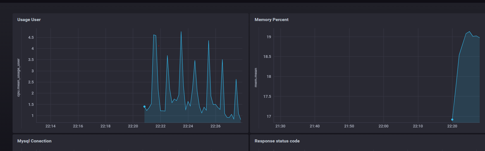

Поднял контейнеры **WordPress** и **MySQL 5.7** (БД). WordPress доступен
на порту 8080, база — на 3306. Связь между ними настроена через переменные
окружения, данные хранятся в Docker volumes.

Telegraf собирает метрики со **всех уровней** с интервалом 10 секунд:
- **VM**: CPU, память, диск, сеть, процессы, swap
- **БД**: MySQL — соединения (`threads_connected`), запросы (`queries`), uptime
- **Приложение**: HTTP-ответы CMS — код (`status_code`) и время (`response_time`)

Метрики отправляются в InfluxDB.

InfluxDB хранит метрики в базе `telegraf`. 

Chronograf подключён к InfluxDB. Создан дашборд **CMS Monitoring** с графиками:
- Usage User
- Memory Used %
- Disk Used %
- Network Traffic
- MySQL Connections
- MySQL Queries per Second
- HTTP Response Time
- HTTP Status Codes

Разработаны 4 TICKscript-правила и **зарегистрированы в Kapacitor** через CLI:
